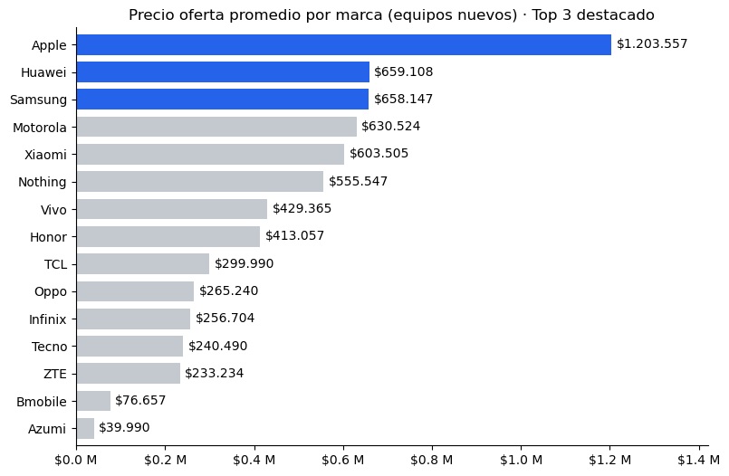
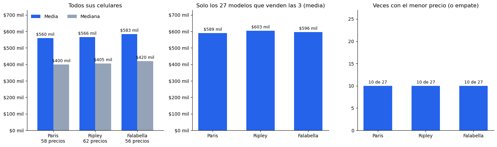
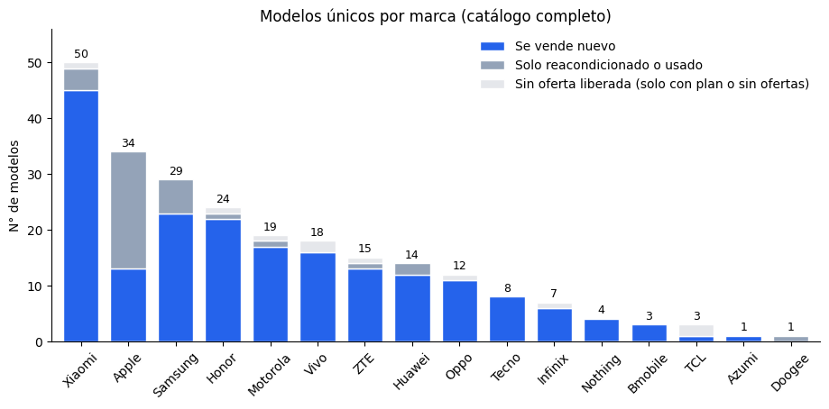
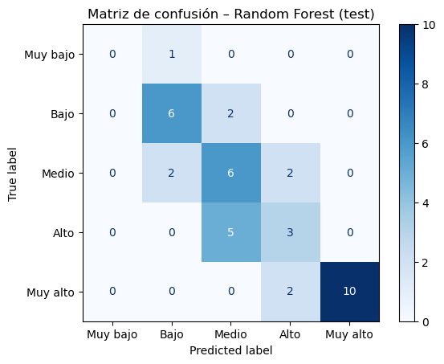
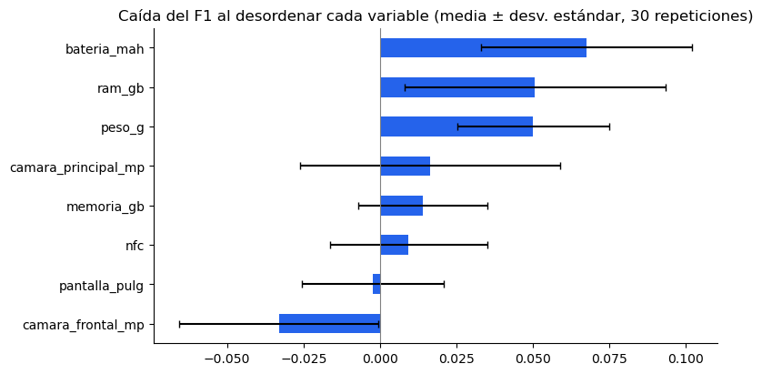

# Mercado de celulares en Chile: web scraping y clasificación de precios


**Tarea 1 · Analítica de Datos (MACI 2026)** · Keyden Urbina

Base de datos construida con **web scraping** de [solotodo.cl/celulares](https://www.solotodo.cl/celulares), análisis de precios por marca y por tienda, y un **modelo de clasificación** que estima el rango de precio de un celular a partir de sus características técnicas.

El enunciado completo está en [`request/Tarea_1.pdf`](request/Tarea_1.pdf).

---

## Contexto

Una emprendedora quiere lanzar su propia marca de celulares y necesita:
1. **Datos actualizados de la competencia:** precios por marca y por tienda.
2. **Una forma de estimar el precio** de sus futuros equipos según sus características, sin suponerlo.

## Resultados principales

Extracción del **08-11-2026 a las 11:55**: 242 celulares de 16 marcas, en 13 páginas del listado.

### a) Marcas con el precio promedio más alto (equipos nuevos)



- **Apple lidera sola** (\$1.203.557), 1,83 veces la segunda.
- **Huawei (\$659.108) y Samsung (\$658.147) están prácticamente empatadas:** \$961 de diferencia (0,1 %). El tercer lugar no es robusto.

### b) Ripley vs. Falabella vs. Paris



- **Paris es la más barata** con ambos métodos: promedio simple y control con los 27 modelos que venden las tres tiendas.
- **La más cara depende del método:** Falabella con el promedio simple y Ripley con los mismos modelos. Las diferencias son pequeñas: 4,2 % y 2,4 %.

### c) Modelos únicos por marca



- **242 modelos de 16 marcas.** Xiaomi (50), Apple (34) y Samsung (29) reúnen el 47 % del catálogo observado.
- De los 34 modelos de Apple, 21 solo se ofrecen reacondicionados o usados.

### Modelo de clasificación del rango de precio

| | F1 macro | Accuracy |
|---|---|---|
| **Random Forest** (elegido por validación) · test | **0,51** | **0,64** |
| Base: siempre "Muy alto" · test | 0,09 | 0,31 |
| Random Forest · validación cruzada (5 particiones) | 0,50 ± 0,07 | — |



- **Todos los errores en test quedan a un rango de distancia.**
- Es un resultado **modesto**: sirve como referencia exploratoria, no para fijar precios directamente.
- **Batería, RAM y peso** son las variables con mayor importancia por permutación, sin un orden concluyente entre ellas.



## Pipeline

| Notebook | Qué hace | Salida |
|---|---|---|
| [`01. web_scraping_raw`](notebooks/01.%20web_scraping_raw.ipynb) | Recorre el listado (`?page=N`, 1 s de pausa), resuelve las páginas de modelo y extrae ficha técnica, ofertas de todas las tiendas, cupones y tipo de oferta, **solo desde el HTML** | `data/output/data_raw.csv` |
| [`02. data_cleaning`](notebooks/02.%20data_cleaning.ipynb) | Diagnóstico de calidad, texto → números, condición, ofertas con plan y publicaciones repetidas | `data/processed/data_processed.csv` |
| [`03. data_exploration`](notebooks/03.%20data_exploration.ipynb) | Preguntas a, b y c, correlaciones y análisis del catálogo | Gráficos e interpretaciones |
| [`04. data_modeling`](notebooks/04.%20data_modeling.ipynb) | Variable `rango_precio`, división 64/16/20, imputación sin fuga de datos, 3 algoritmos, evaluación en test e importancia | Modelo y métricas |

## Datos

| Archivo | Contenido |
|---|---|
| `data/output/data_raw.csv` | **RAW sin limpiar:** 1.104 filas × 35 columnas. Una fila por oferta (celular × tienda), incluidas las ofertas con plan |
| `data/output/data_raw_20261108_1155.csv` | Copia con fecha de la misma extracción |
| `data/output/comprobacion_variantes.csv` | Variante mostrada al hacer clic vs. primera de la lista interna, en las 13 páginas de modelo |
| `data/processed/data_processed.csv` | **Datos limpios:** 1.006 filas × 17 columnas, 242 celulares |

<details>
<summary><b>Diccionario de <code>data_processed.csv</code></b></summary>

| Columna | Descripción |
|---|---|
| `nombre` | Identificador único: nombre del producto con su variante |
| `marca` | Fabricante |
| `disponibilidad` | Liberado / Solo con plan / Sin ofertas |
| `tienda` | Tienda de la oferta |
| `id_oferta` | Identificador de la publicación en solotodo (trazabilidad) |
| `condicion` | nuevo / reacondicionado / usado |
| `es_nuevo` | 1 si es nuevo, 0 si no |
| `precio_normal` | Precio normal o con todo medio de pago (CLP) |
| `precio_oferta` | Precio con tarjeta o con cupón (CLP) |
| `memoria_gb`, `ram_gb` | Almacenamiento y RAM en GB |
| `pantalla_pulg` | Tamaño de pantalla en pulgadas |
| `camara_principal_mp` | Suma de los MP de las cámaras traseras |
| `camara_frontal_mp` | MP de la cámara frontal |
| `bateria_mah` | Batería en mAh |
| `peso_g` | Peso en gramos |
| `nfc` | 1 si tiene NFC, 0 si no |

</details>

## Decisiones metodológicas

- **Solo HTML, sin la API pública** del sitio. Las ofertas ocultas tras "Ver más precios" salen del `ld+json` y de los datos embebidos en la página.
- **Variante de las páginas de modelo:** la que la página muestra al hacer clic (`?product=` del enlace), como pide el enunciado. La primera de la lista interna difiere en 9 de 13 páginas (en 6 iPhone es la de 1 TB).
- **Ofertas con plan:** se guardan en el RAW y se excluyen en la limpieza, porque su precio corresponde a un arriendo con plan.
- **Publicaciones repetidas** (mismo celular, tienda y precio, con distinto `id_oferta`): se deja una para no duplicar su peso en los promedios.
- **Imputación sin fuga de datos:** las características faltantes se imputan en el notebook 04 con medianas aprendidas solo con el conjunto de entrenamiento.
- **Una fila por modelo en el clasificador** (precio = mediana entre tiendas), para que el mismo celular no quede en entrenamiento y en test.

## Estructura del repositorio

```
├── data/
│   ├── input/                 # HTML descargado (no se sube a GitHub)
│   ├── output/                # RAW y tabla de comprobación de variantes
│   └── processed/             # Datos limpios
├── images/                    # Gráficos del README
├── notebooks/                 # 01 → 04, en orden
├── request/Tarea_1.pdf        # Enunciado
├── requirements.txt
└── README.md
```

## Cómo reproducirlo

```bash
git clone https://github.com/keydenurbina/cellphones-market.git
cd cellphones-market
pip install -r requirements.txt
```

Ejecuta los notebooks **en orden (01 → 04)**, cada uno con *Reiniciar → Ejecutar todo*.

- El notebook 01 descarga ~280 páginas con 1 s de pausa (5–6 minutos) y guarda el HTML en `data/input/html_AAAAMMDD/`. Si se corta o se vuelve a ejecutar el mismo día, lee lo ya descargado.
- **Los precios cambian a diario:** una extracción en otra fecha dará cifras distintas a las de este README.

## Limitaciones

- **Muestras pequeñas:** 195 modelos en el clasificador y 39 en test. La clase "Muy bajo" tiene solo 7 modelos.
- **Una sola fecha de extracción:** los precios reflejan el 08-11-2026.
- **Contar modelos no mide ventas** ni participación de mercado.
- **Las correlaciones describen asociaciones**, no causas.

---

*Proyecto académico. Los datos provienen de páginas públicas de solotodo.cl y se usan solo con fines educativos.*
